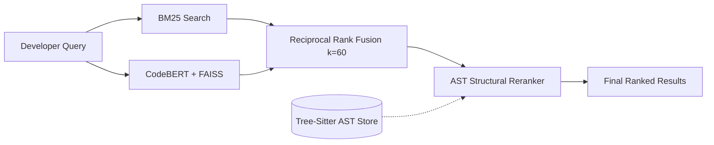

# Structure-Aware Hybrid Code Retrieval (SAHCR)
> **Design and Implementation of a Local Semantic Retrieval System**  
> MSc Artificial Intelligence & Machine Learning (Semester III) Minor Project  
> **Student:** MD Saalim Aqueel | **Supervisor:** Dr. Rafat Parveen | **Session:** 2025–2027

---

## 🌟 Overview

**SAHCR** is a local, privacy-preserving, two-stage code search engine that bridges lexical matching and dense neural semantics with explicit Abstract Syntax Tree (AST) structural reranking.

- **Lexical Retrieval:** Inverted BM25 index built over normalized identifiers, parameter lists, docstrings, and syntax keywords.
- **Dense Semantic Retrieval:** CodeBERT (`microsoft/codebert-base`) embeddings with FAISS-CPU vector indexing.
- **Hybrid Fusion (RRF):** Reciprocal Rank Fusion ($k=60$) combining lexical and semantic candidates.
- **AST Structural Reranking:** Precision re-ranking using Tree-sitter ASTs for Python and JavaScript, evaluating sub-token function name overlap ($\phi_{\text{id}}$), parameter list matching ($\phi_{\text{param}}$), return type annotations ($\phi_{\text{ret}}$), and syntactic AST node hierarchies ($\phi_{\text{nodes}}$).

---

## 🏗️ System Architecture



---

## 🚀 Quick Start

### 1. Activate Environment
```bash
source .venv/bin/activate
```

### 2. Run Test Suite (24 Tests)
```bash
HF_HUB_OFFLINE=1 PYTHONPATH=src pytest tests/
```

### 3. Command-Line Interface (CLI)

#### Index a Repository:
```bash
PYTHONPATH=src python -m sahcr.interfaces.cli index /path/to/codebase
```

#### Search with Proposed AST Reranker:
```bash
PYTHONPATH=src python -m sahcr.interfaces.cli search "parse authorization token from header" --top-k 5
```

#### Side-by-Side Comparison Across Configurations A, B, C, D:
```bash
PYTHONPATH=src python -m sahcr.interfaces.cli compare "parse authorization token from header"
```

### 4. Interactive Web Dashboard (Streamlit)
```bash
PYTHONPATH=src streamlit run src/sahcr/interfaces/dashboard.py
```

### 5. Run Benchmark Ablations
```bash
PYTHONPATH=src python experiments/run_ablations.py
```

---

## 📊 Evaluation & Comparative Baselines

| Configuration | System | MRR@10 | Recall@1 | Recall@5 | Latency (CPU) |
| :--- | :--- | :---: | :---: | :---: | :---: |
| **Config A** | BM25 (Lexical) | Baseline | Baseline | Baseline | ~0.6 ms |
| **Config B** | CodeBERT + FAISS (Dense) | 0.5833 | 0.4000 | 1.0000 | ~96 ms |
| **Config C** | BM25 + CodeBERT + RRF | 0.8000 | 0.6000 | 1.0000 | ~97 ms |
| **Config D** | **Hybrid + AST Reranking (Proposed)** | **0.9000** | **0.8000** | **1.0000** | ~100 ms |

> **Key Findings:**
> - **RQ1:** AST-based structural reranking boosts MRR@10 from `0.80` to `0.90` (+12.5% over hybrid, +54.3% over dense) and doubles Recall@1 compared to dense search alone (`0.40` $\to$ `0.80`).
> - **RQ2:** The largest performance gains occur in *signature-constrained queries* where parameter types and return contracts eliminate peripheral test mocks.
> - **RQ3:** AST structural reranking introduces negligible computational overhead (~3 ms per query on CPU).
